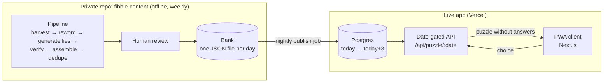

# Fibble

**Two truths. One fib. Five rounds.** A daily "Two Truths and a Lie" trivia game where the
truths come from Wikipedia and the lie is written by an LLM, then checked by a second model
and a human before it ships.

> **Status: pre-alpha.** The monorepo, puzzle schema, sample content and a static first round
> are in place. Swipe play, reveals, the database and the real content pipeline are not built yet.

<!-- Demo GIF goes here: a 5-second swipe through one round and the reveal. -->

_Demo GIF coming soon._

## How it works

Puzzles are generated offline in weekly batches, human-reviewed, and stored in a **private**
content repo. A nightly job publishes only the next few days to Postgres, and the API never
returns a date that hasn't started yet anywhere on Earth.



Answers never reach the client before the player picks a card: the puzzle endpoint
returns only statement text, and the answer endpoint reveals one round at a time.

## How the lies are made

The content pipeline (in [`packages/pipeline`](packages/pipeline)) has seven stages, each
writing a versioned record so any shipped statement can be traced to its source revision,
prompt version and reviewer.

1. **Harvest** candidate truths from Wikipedia's "Did you know…" archive and the Unusual
   articles list, with article context and revision IDs.
2. **Reword** each claim into house style (80 to 160 characters, our own words), then have
   a separate model check that the source supports every detail.
3. **Generate lies** with Claude Opus: fully invented claims that match the truths' length
   and specificity, never one-detail edits of real facts, and never about living people.
4. **Verify the lie is false** with a different model (Claude Sonnet) reading retrieved
   Wikipedia and web evidence. Only lies the evidence contradicts or doesn't mention pass.
5. **Assemble** rounds and run a style spotter (Claude Haiku) that guesses the lie 10 times;
   lies it finds more than 70% of the time get regenerated.
6. **Deduplicate** against the whole bank by embedding similarity and article reuse.
7. **Human review**: every round is approved, edited or rejected by a person.

See the [example lie-generation prompt](packages/pipeline/prompts/example-v1/generate-lies.md)
and the [eval format](packages/pipeline/evals/README.md). Production prompts live in the
private repo. More detail in [docs/architecture.md](docs/architecture.md).

## Built with LLMs

This repo is being built with Claude Code. The log of what was delegated, what was
hand-written and what we learned is in [docs/ai-development.md](docs/ai-development.md).
Architecture decisions are recorded in [docs/adr](docs/adr).

## Local quickstart

Requires Node 26 (see `.nvmrc`) and pnpm 12.

```bash
nvm use                 # Node 26.13.1
npm i -g pnpm@12.23.0   # the version pinned in package.json
pnpm install
pnpm dev                # http://localhost:3000 shows a sample round
```

| Command                 | What it does                                       |
| ----------------------- | -------------------------------------------------- |
| `pnpm dev`              | Run the web app in development mode                |
| `pnpm build`            | Production build of every package                  |
| `pnpm lint`             | ESLint across the monorepo                         |
| `pnpm typecheck`        | TypeScript strict-mode checks                      |
| `pnpm test`             | Vitest unit and API tests                          |
| `pnpm validate:content` | Check `content-example/` against the puzzle schema |
| `pnpm harvest`          | Pipeline stage 1: harvest DYK hooks (see below)    |
| `pnpm format`           | Format with Prettier                               |

The app reads the three sample days in [`content-example/`](content-example), so no
database or API keys are needed to run it. Copy `.env.example` to `.env.local` only when
working on the pipeline.

`pnpm harvest --months 2024-05 --limit 100 --out out/candidates.jsonl` reads Wikipedia's
"Did you know…" archive for those months and writes candidate truths with their source
revision, evidence text and a living-person flag. It calls only free Wikipedia and Wikidata
APIs, politely, and caches every response in `.cache/wikipedia/`.

## Repo layout

```
apps/web/              Next.js game and API routes (PWA later)
packages/shared/       Puzzle types, Zod schemas and pure game logic
packages/pipeline/     Content pipeline stages, prompts and evals
tools/review/          Local review UI (placeholder)
content-example/       3 sample days
docs/                  Architecture, ADRs, AI-development log
```

## License and attribution

The code is licensed under the [GNU AGPL-3.0](LICENSE).

Facts in the sample content are adapted from [Wikipedia](https://en.wikipedia.org/) and are
available under [CC BY-SA 4.0](https://creativecommons.org/licenses/by-sa/4.0/). Each truth
is rewritten in our own words and links to its source article and the exact revision it was
checked against; the article history lists its authors. The invented lies are not from
Wikipedia. Fibble is not affiliated with or endorsed by Wikipedia or the Wikimedia Foundation.
