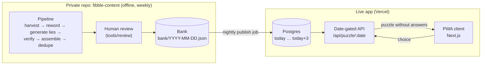

# Architecture

Fibble is one TypeScript monorepo for the game and the content pipeline, hosted on Vercel
with Postgres. The interesting part is offline: a generate-then-verify pipeline that makes
believable lies and proves they are false before a human approves them.

## System overview

The top row runs weekly and offline. Only the bottom row is live, and it only ever holds the
next few days.

## Packages

| Package             | Role                                                                                                                | Depends on                    |
| ------------------- | ------------------------------------------------------------------------------------------------------------------- | ----------------------------- |
| `packages/shared`   | Zod schemas (source of truth), inferred types, pure functions: date gating, public view, answer grading, share text | `zod`                         |
| `packages/pipeline` | Typed stages, model config, prompts, evals, `validate:content`                                                      | `shared`, `@anthropic-ai/sdk` |
| `apps/web`          | Next.js App Router game, route handlers, `ContentSource`                                                            | `shared`                      |
| `tools/review`      | Local review UI (placeholder)                                                                                       | —                             |

`shared` exports TypeScript source directly; Next.js compiles it via `transpilePackages`, and
Vitest and `tsx` run it as-is. There is no separate build step for libraries.

## Data model

Defined in [`packages/shared/src/schema.ts`](../packages/shared/src/schema.ts):

- **Statement**: `text` (80 to 160 characters), plus `expansion` (one sentence) and `source`
  (`title`, `url`, `revisionId`) on truths only. The lie has neither.
- **Round**: `category`, `difficulty` (1 to 5), exactly 3 `statements`, `lieIndex` (0 to 2),
  and `lieNote` (the "why it sounded true" line).
- **Puzzle**: `date` (YYYY-MM-DD), `puzzleNumber`, exactly 5 `rounds` in the fixed category
  order, and an optional `sample` flag used only by `content-example/`.
- **PublicPuzzle**: what the client gets. Statement text only. It is built by copying an
  allow-list of fields and then parsed with a strict schema, so a new answer field can't
  leak by default.
- **AnswerResult**: returned after a choice: `correct`, `lieIndex`, `lieNote`, and each
  truth's `expansion` and `source`.

## Date gating

A date is **released** once it has started in UTC+14, the earliest time zone on Earth, so
nobody can fetch tomorrow early from anywhere. A date is **archived** once it ended
everywhere (UTC-12) more than 24 hours ago; archived dates are refused unless the content
source allows archive access. Unreleased and missing dates return the same 404, so the API
never reveals whether a future puzzle exists.

All route handlers go through `getPlayablePuzzle` in
[`apps/web/src/lib/puzzle-service.ts`](../apps/web/src/lib/puzzle-service.ts), so no endpoint
can skip the gate.

## API

| Endpoint                                 | Returns                                                                                   | Status  |
| ---------------------------------------- | ----------------------------------------------------------------------------------------- | ------- |
| `GET /api/puzzle/:date`                  | `PublicPuzzle`, or 404 for unreleased, archived or missing dates; 400 for malformed dates | Built   |
| `POST /api/puzzle/:date/round/:n/answer` | `AnswerResult` for `{ "choice": 0 \| 1 \| 2 }`                                            | Built   |
| `GET /api/puzzle/:date/stats`            | Per-round fool rates, after finishing                                                     | Planned |
| `POST /api/report`                       | Stores a problem report                                                                   | Planned |

A determined player can call the answer endpoint to peek. That only spoils their own game,
which is acceptable for a casual daily (PRD section 6).

## Content sources

The app depends on a `ContentSource` interface, not on storage:

- `FileContentSource` reads one JSON file per day from a folder. It powers local dev and
  tests using `content-example/`, with archive access on so the past sample days load.
- A Postgres source (Neon + Drizzle) will serve production. It is not built yet.

## Content flow (planned)

1. The pipeline runs in the private `fibble-content` repo, importing `@fibble/pipeline` at a
   pinned version and using private production prompts.
2. Approved days are stored there as `bank/YYYY-MM-DD.json` and validated with the shared
   schema (`pnpm validate:content path/to/bank`).
3. A nightly GitHub Action upserts **today through today + 3** into the production database.
   The buffer covers a failed run; the API's date gate keeps future days hidden.
4. Secrets (database URL, search API key) live in GitHub Actions secrets and Vercel
   environment variables, never in either repo. Claude access needs no stored key: `ant auth
login` locally and workload identity federation in Actions
   ([ADR 0005](adr/0005-verification-search-and-keyless-auth.md)).

## Pipeline and models

See [ADR 0004](adr/0004-model-per-stage.md) and
[`packages/pipeline/src/models.ts`](../packages/pipeline/src/models.ts).

| Stage                                           | Model               |
| ----------------------------------------------- | ------------------- |
| Lie generation, entailment check                | `claude-opus-5-5`   |
| Lie verification judge                          | `claude-sonnet-5-5` |
| Classification, rewording drafts, style spotter | `claude-haiku-5-5`  |

Every stage is typed in [`packages/pipeline/src/types.ts`](../packages/pipeline/src/types.ts)
and currently throws `NotImplementedError`.
