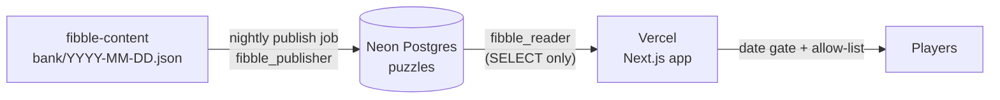

# Hosting

How Fibble runs in production, and how to set it up from scratch. Design: [ADR 0012](adr/0012-hosting-vercel-neon.md).



- **Neon** stores the published days: **today through today + 3** (UTC).
- **Vercel** runs the app. It reads with a role that can only `SELECT`, and the date gate
  decides what is visible.
- **The private repo's nightly job** publishes with a role that can insert and update, but
  never delete.
- **No connection string lives in either repo.** They live in 1Password, Vercel and GitHub
  Actions secrets.

## 1. Neon

1. Create a project named `fibble` in **AWS US East 1 (N. Virginia)**, close to Vercel's
   default region. The free plan is enough.
2. In 1Password, create two **Database** items, `fibble-neon-reader` and
   `fibble-neon-publisher`. Give each a generated password: 32 characters, **no symbols**,
   so it's safe inside a URL.
3. In Neon's **SQL Editor** (branch `production`, database `neondb`), create the roles:
   ```sql
   CREATE ROLE fibble_reader    WITH LOGIN PASSWORD '<from 1Password>';
   CREATE ROLE fibble_publisher WITH LOGIN PASSWORD '<from 1Password>';
   ```
   Create roles in SQL, not with Neon's "New role" button: console-made roles get broad
   admin rights.
4. Run [`packages/db/migrations/0001_puzzles.sql`](../packages/db/migrations/0001_puzzles.sql)
   in the SQL Editor. It creates the table and grants the two roles their privileges.
5. In each 1Password item, add a hidden field `connection string`:
   `postgresql://<role>:<password>@<host>/neondb?sslmode=require`. The host is shown in
   Neon's **Connect** dialog. Don't save the owner's connection string anywhere.
6. Check both roles:
   ```bash
   DATABASE_URL_PUBLISHER="op://Private/fibble-neon-publisher/connection string" op run -- pnpm db:check --role publisher
   DATABASE_URL="op://Private/fibble-neon-reader/connection string" op run -- pnpm db:check --role reader
   ```
   The reader may only SELECT; the publisher may SELECT, INSERT and UPDATE, never DELETE.

## 2. Secrets for the publish job (private repo)

```bash
op read "op://Private/fibble-neon-publisher/connection string" \
  | gh secret set DATABASE_URL_PUBLISHER --repo awoods187/fibble-content
```

## 3. Vercel

1. Sign up with GitHub (Hobby). **Add New → Project → Import** `awoods187/fibble`. Give
   Vercel's GitHub app access to **this repo only**, never `fibble-content`.
2. **Root Directory:** `apps/web`. Leave the build and install commands as they are.
3. **Environment variables:**
   - `ENABLE_EXPERIMENTAL_COREPACK` = `1` (all environments), so Vercel uses the pinned pnpm
   - `DATABASE_URL` = the reader's connection string (**Production only**)

   Preview deployments get no database, so they serve the sample days.

4. **Deploy.** Vercel's default is Node 26, which matches `.nvmrc`.
5. **Firewall:** add a rate-limit rule on paths starting with `/api/` (for example 60
   requests a minute per IP), if your plan includes one.

## 4. Publishing

- **The nightly job,** `fibble-content/.github/workflows/publish.yml`, runs
  `pnpm publish-days --bank bank` at 00:15 UTC.
- **By hand,** from `fibble-content` (its runner adds `op run`):
  ```bash
  pnpm publish-days --bank bank --dry-run   # the plan
  pnpm publish-days --bank bank             # publish
  ```
- **What it enforces:**
  - Every day must pass the schema and the banned-topic filter, and must not be a sample.
  - One invalid day stops the whole run before any write.
  - A day that's already live is never changed; the kill switch is a separate, later tool.

## Smoke test (sample days)

Publish the sample days once by hand, then check the live site:

```bash
DATABASE_URL_PUBLISHER="op://Private/fibble-neon-publisher/connection string" \
  op run -- pnpm publish-days --bank content-example --allow-sample
curl -s https://<your-app>.vercel.app/api/puzzle/$(date -u +%F) | head -c 300
```

`--allow-sample` exists only for this test. CI never passes it.
